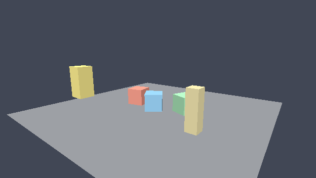

# Zypher

An open source game engine for **macOS and Windows** — a C++23 runtime with C#
gameplay scripting, Rust asset tooling, and a TypeScript/QML editor.

Zypher is built to be hackable end to end: every format is documented, the core
has no required third-party dependency, and the whole pipeline (cook → pack →
simulate → render → verify) runs headlessly so it can be tested in CI.

```
C++23 engine core   Rust asset cooker   C# gameplay (NativeAOT)
       \                  |                  /
        \---- .zpkg pack file --------------/
                       |
        runtime (zypher_runtime) + editor (Qt 6 / QML + TypeScript)
```

## Status — 0.1.0 "Foundations"

This milestone ships a complete, tested core and toolchain. It is not yet a
drop-in Unity replacement; GPU backends and third-party integrations are the
next milestone and are listed honestly in [docs/roadmap.md](docs/roadmap.md).

**Implemented and verified on this checkout**

| Area | What is here |
| --- | --- |
| Engine core | Allocators/arenas, jobs, logging, results/errors, time, config (CLI + INI), file system, platform layer |
| ECS | Sparse-set registry with transforms, mesh renderers, cameras, rigid bodies, scripts, names |
| Math | Vectors, matrices, quaternions, TRS composition, inverses, projections, `lookAt` |
| Assets | FNV-1a asset ids, `.zpkg` pack reader/writer with CRC32, mesh blob codec, asset registry with caching |
| Scene | `.zscene` JSON parse → ECS instantiation → serialise back |
| Simulation | AABB rigid bodies with resting contacts, kinematic-style character motion, fixed timestep, A* navigation grid |
| Rendering | Deterministic **software rasteriser** with depth buffer, back-face culling and PNG output; GPU backends are scaffolds |
| Scripting | Native C ABI v1: a C# game assembly published with .NET NativeAOT is `dlopen`ed/LoadLibrary'd and driven per frame |
| Runtime | `zypher_runtime` CLI: scene + pack loading, frame loop, frame dump, checksum report |
| Asset cooker | Rust (`tools/assetcooker`): project manifests, OBJ/glTF/GLB, textures, audio, mesh blobs, `.zpkg` packing |
| Editor core | Project/session model with selection, transform edits, rename/add/remove, reorder, undo/redo, save |
| Editor UI | QML panels (hierarchy, inspector, asset browser, console) and their TypeScript logic + tests |
| Tooling | Python asset validation, reproducible release packaging, one-command verification |
| CI | Linux headless core tests, Rust, TypeScript, C#, macOS and Windows builds; tag releases |

**Not wired up yet** (options fail fast instead of silently doing nothing):
Vulkan, Direct3D 12, Metal, MoltenVK, OpenGL, SDL3, Jolt, Box2D, Recast,
miniaudio, Assimp, meshoptimizer, Dear ImGui, FreeType, HarfBuzz, Tracy,
Crashpad and the Lua host. Shader sources (GLSL, HLSL, MSL, Slang) are included
but are not compiled by CI yet.

## Quick start

Requirements: CMake 3.24+, Ninja (recommended), a C++23 compiler (Apple Clang 16
on macOS, Visual Studio 2022 on Windows, GCC 13+ on Linux for CI), Rust for the
cooker, Node 20+ for editor panels, .NET 8 SDK for C# scripting.

```bash
# 1. Build the engine, runtime and tests
cmake -S . -B build -G Ninja -DCMAKE_BUILD_TYPE=RelWithDebInfo \
      -DZYPHER_BUILD_TESTS=ON -DZYPHER_BUILD_EDITOR=ON
cmake --build build

# 2. Run the test suites
ctest --test-dir build --output-on-failure
./build/bin/zypher_tests

# 3. Cook the demo project (writes samples/demo/dist/demo.zpkg)
cargo run --manifest-path tools/assetcooker/Cargo.toml -- \
      --project samples/demo/zypher.project.json --verbose

# 4. Simulate and render 120 steps, dumping a PNG + report
./build/bin/zypher_runtime \
      --scene samples/demo/scene.zscene \
      --pack samples/demo/dist/demo.zpkg \
      --output artifacts --width 640 --height 360 \
      --frames 2 --steps 120 --dump-frame
```

On Windows use `build\bin\zypher_runtime.exe` (or `build\bin\Release\...` with a
multi-config generator).

Or run every check the host supports:

```bash
python3 tools/scripts/run_checks.py
```



## Editor

The editor core builds without Qt and is covered by tests. The Qt 6/QML desktop
shell builds when Qt 6.5+ is available:

```bash
cmake -S . -B build-editor -DZYPHER_BUILD_EDITOR=ON -DQt6_DIR=/path/to/Qt/6.8.0/macos/lib/cmake/Qt6
cmake --build build-editor
./build-editor/bin/zypher_editor
```

The TypeScript panel logic lives in `editor/ts` and is typechecked and tested
with Node's built-in test runner. See [docs/editor.md](docs/editor.md).

## Gameplay scripting

```csharp
public sealed class PlayerController : Behaviour
{
    public override void OnUpdate()
    {
        Vector3 position = Position;
        Position = new Vector3(position.X + DeltaSeconds * 1.2f, position.Y, position.Z);
    }
}
```

Export the module from your game assembly:

```csharp
[UnmanagedCallersOnly(EntryPoint = "zypher_script_module")]
public static IntPtr ZypherScriptModule()
{
    var registry = new ScriptRegistry();
    registry.Add<PlayerController>("PlayerController");
    return ScriptHostBridge.CreateModule("My Game", registry);
}
```

Publish with `dotnet publish -c Release -r osx-arm64 -p:PublishAot=true -p:NativeLib=Shared`
(or `win-x64`). The runtime loads the resulting library automatically when it
sits next to the executable as `scripts` / `<assembly>.dylib` / `.dll`.
See [docs/scripting.md](docs/scripting.md).

## Documentation

- [Architecture](docs/architecture.md) — module map, frame loop, data flow
- [Building](docs/building.md) — platform prerequisites and CMake options
- [Formats](docs/formats.md) — `.zpkg`, mesh blob, `.zscene`, project manifest
- [Scripting](docs/scripting.md) — C# ABI, lifecycle, publishing
- [Editor](docs/editor.md) — Qt/QML shell and TypeScript panels
- [Roadmap](docs/roadmap.md) — integration status for the full technology list
- [Releases](docs/releases.md) — artifacts, checksums, how they are built
- [Contributing](CONTRIBUTING.md)

## Repository layout

```
engine/        C++23 engine (core, assets, scene, physics, nav, render, script host, runtime)
engine/shaders GLSL / HLSL / MSL / Slang standard shaders
engine/scripting/csharp  C# gameplay runtime (Zypher.Scripting)
editor/        editor core, Qt/QML shell and TypeScript panel logic
tools/         Rust asset cooker, Python automation, C# test harness
tests/         engine unit + integration tests
samples/demo/  demo project, scene, meshes and gameplay scripts
docs/          architecture, formats, scripting, editor, roadmap, releases
```

## Platforms

macOS and Windows are the shipping targets. Linux is supported for headless CI
verification of the platform-independent core (software rasteriser, null audio,
POSIX file layer); it is not a shipping target.

## License

MIT — see [LICENSE](LICENSE).
